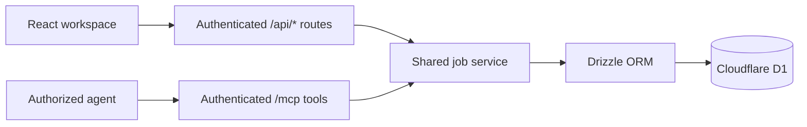

# Next Move · 下一站

A bilingual job-search workspace for turning scattered job postings into a clear application pipeline. Save the original job description, organize roles by company, and track what happened—and what to do next.

一个中英双语求职工作台：集中保存岗位与 JD，按公司整理机会，追踪投递、面试和下一步行动。

[English](#english) · [简体中文](#chinese) · [中文独立文档](README.zh-CN.md)

**React 19 · TypeScript · Vinext / Vite · Cloudflare Workers / D1 · Drizzle ORM · MCP**

This repository is a source release for a privately used product. It starts with an empty dataset; the private instance is not a public demo. No personal job-search screenshots or live private-site link are included here.

<a id="english"></a>

## English

### The problem

A job search often spans browser bookmarks, spreadsheets, several resume versions, and notes from conversations. Postings can change or disappear, and several roles at the same company can become difficult to distinguish. A saved opportunity also needs to remain distinct from an application that was actually submitted.

Next Move puts those pieces into one workspace. Each role retains its own original JD, source, resume version, status, and timeline. Company groups make browsing manageable without merging the underlying records. An authorized agent can help maintain the same data through MCP.

### Product features

- **Company, list, and board views:** expand a company to browse its roles, or switch to a flat list or status board. Search includes saved JD text; filters, sorting, and pagination support longer lists.
- **Application history:** track saved, ready, applied, screening, interviewing, offer, rejected, and withdrawn states, alongside the actual application date, contacts, resume version, and notes.
- **Next actions and follow-ups:** see overdue, due-today, and upcoming work. Product dates use the `America/Toronto` time zone.
- **English and Simplified Chinese:** switch labels, forms, dates, errors, and CSV headings. Saved JDs, notes, company names, tags, and source text keep their original content. Browser preferences remember language, view, and sorting.
- **Recoverable records and portable data:** archive and restore roles; export full JSON backups or CSV matching the current filters across all result pages. JSON imports skip existing roles rather than overwrite their progress.
- **dot collaboration:** authenticated MCP tools can read roles, add or update records, append notes, archive or restore opportunities, and list due follow-ups.

Marking a role as applied records a completed application; it does not submit a resume to an employer. MCP submission updates require an `applicationEvidence` explanation. The tools maintain records rather than send applications or messages. Scheduled notifications require a separately configured automation; follow-up dates alone appear in the workspace.

### Architecture and engineering decisions



- **One domain layer for the UI and agent.** Both entry points use [`lib/jobs.ts`](lib/jobs.ts) for validation, persistence, imports, and history. MCP does not maintain a separate copy of the user's records.
- **User-scoped persistence.** Sites-managed ChatGPT sign-in supplies the identity. Queries and updates use that user ID; browser write routes also check request origin and JSON content type. See [`app/chatgpt-auth.ts`](app/chatgpt-auth.ts) and [`app/api/route-utils.ts`](app/api/route-utils.ts).
- **Optimistic concurrency.** Updates match the record ID, user ID, and current version in the database. A conflicting write returns `409 VERSION_CONFLICT`, allowing the UI to request a refresh instead of silently overwriting newer fields or history.
- **Validated imports and bounded requests.** Input checks cover required fields, field lengths, enums, real calendar dates, and HTTP/HTTPS job URLs. Request bodies are bounded while streaming. Imports validate each batch before writing, deduplicate against existing roles, and use a transactional D1 batch for inserts.
- **Spreadsheet-aware exports.** CSV cells are quoted and escape embedded quotes; common spreadsheet formula prefixes are neutralized. JSON preserves full records and timelines, while CSV is designed for review and analysis.
- **Content-preserving localization.** [`lib/i18n.tsx`](lib/i18n.tsx) keeps translated interface labels separate from stored data and stable API identifiers. Calendar dates and timestamps are formatted deliberately in the product time zone, with localized validation feedback.

The UI uses React 19 and TypeScript on Vinext/Vite, with a Cloudflare Worker and a D1 database accessed through Drizzle ORM. The framework and hosting integration come from the Sites/Vinext starter; this repository contains the job-tracking application built on top. Vendored integration files retain their upstream notices.

Useful entry points:

- [`components/job-workspace.tsx`](components/job-workspace.tsx): workspace, forms, role details, reminders, and import/export controls.
- [`components/company-job-list.tsx`](components/company-job-list.tsx) and [`lib/company-groups.ts`](lib/company-groups.ts): company grouping, per-company browsing, and sorting.
- [`db/schema.ts`](db/schema.ts) and [`drizzle/`](drizzle/): persistent schema and migrations.
- [`app/mcp/route.ts`](app/mcp/route.ts): agent tools and the application-evidence requirement.
- [`scripts/check-i18n.mjs`](scripts/check-i18n.mjs): locale regression checks for dates, status labels, validation messages, and storage-independent server rendering.

### Run locally

Use **Node.js 22.13 or newer**.

```sh
npm ci
npm run build
npx wrangler d1 execute DB --local --config dist/server/wrangler.json --persist-to .wrangler/state --file drizzle/0000_mysterious_wrecking_crew.sql
npm run dev
```

The build generates the local Worker configuration; the SQL command initializes a fresh local D1 database. Run that initialization once. For subsequent sessions, use `npm run dev`; apply future schema changes through their corresponding migrations.

Open the local URL printed by the server. The development preview supports simulated ChatGPT sign-in at `/signin-with-chatgpt?return_to=/`; production sign-in is managed by Sites. The distributed candidate seed is empty, so add your own sample roles or import your own JSON backup.

Validation commands:

```sh
npm run check:types
npm run check:i18n
npm run build
```

`check:types` runs TypeScript. `check:i18n` exercises localized statuses and priorities, server validation errors, Toronto-aware dates, and the initial server render. `build` produces the Worker and client assets in `dist/`.

Use `npm start` to serve the production Worker build locally. Simulated sign-in is provided by the development server. After changing the database schema, `npm run db:generate` generates a new migration; generating a migration does not apply it to a database.

### Source distribution and deployment

This source distribution ships an empty [`lib/seed-jobs.json`](lib/seed-jobs.json) and excludes private runtime data, local databases, backups, credentials, and the existing Site project ID. Schema and migration files define structure rather than personal application rows. The existing private instance retains its own deployment binding and user data.

To deploy your own copy through Sites, register a separate Site and save its returned project ID in `.openai/hosting.json`. Retain the logical `DB` D1 binding and `mcp` capability, and deploy database migrations with their matching application version. Use your own deployment identity and credentials.

[`docs/source-history.md`](docs/source-history.md) records the original development snapshots and how they were prepared for this distribution. Original development dates are retained where documented; removing personal seed data and deployment identity produces different distribution commit hashes.

---

<a id="chinese"></a>

## 简体中文

### 解决的问题

求职记录经常分散在浏览器收藏、表格、不同版本的简历和沟通笔记中。招聘页面可能更新或下线，同一公司的多个岗位也容易混淆；而“收藏了岗位”和“已经完成投递”需要明确区分。

下一站把这些信息放进同一个工作台。每个岗位独立保存 JD 原文、来源、简历版本、状态和时间线；公司分组方便浏览，同时保留各岗位的独立记录。经过授权的 dot 也能通过 MCP 维护同一份数据。

### 主要功能

- **公司、列表和看板视图**：展开公司查看多个岗位，也可切换为岗位列表或进度看板。支持 JD 内容搜索、筛选、排序和分页。
- **投递与面试记录**：涵盖待准备、待投递、已投递、初筛、面试、Offer、未通过和撤回状态，记录真实投递日期、联系人、简历版本与沟通笔记。
- **下一步和跟进日程**：集中查看逾期、今日到期和后续事项，日期按 `America/Toronto` 时区处理。
- **中英切换**：界面、表单、日期、错误提示和 CSV 列名随语言切换。已保存的 JD、笔记、公司名、标签和来源保留原文，浏览器记住语言、视图和排序偏好。
- **归档与数据备份**：岗位可以归档、恢复；JSON 保留完整记录和时间线，CSV 导出当前筛选的全部结果，不受当前页限制。导入会跳过已有岗位，不覆盖现有进度。
- **dot 协作**：通过经过身份验证的 MCP 工具读取、添加和更新岗位，记录进展，归档或恢复机会，查询到期跟进。

“标记已投递”用于记录已经完成的申请，不向雇主发送简历。MCP 工具记录投递或后续状态时，需要提供 `applicationEvidence` 说明。工具负责维护记录，不代为申请或发送消息；单独设置跟进日期只会在工作台显示，需要定时通知时应另外配置自动化。

### 架构与实现选择

网页界面通过 `/api/*` 访问岗位服务，授权代理通过 `/mcp` 访问同一服务，再由 Drizzle ORM 读写 Cloudflare D1。前端采用 React 19、TypeScript 和 Vinext/Vite，服务运行于 Cloudflare Workers。

- **网页和代理共用业务逻辑**：[`lib/jobs.ts`](lib/jobs.ts) 集中处理校验、持久化、导入与历史记录，避免另建一份代理数据。
- **按用户限定数据访问**：身份由 Sites 管理的 ChatGPT 登录提供；数据库查询和更新带入用户 ID，浏览器写请求额外检查来源及 JSON 内容类型。
- **版本并发控制**：更新同时匹配用户 ID、岗位 ID 和当前版本。冲突时返回 `409 VERSION_CONFLICT`，提示刷新，避免静默覆盖较新的字段或时间线。
- **导入与请求校验**：校验必填字段、长度、枚举、有效日期和 HTTP/HTTPS 链接；流式读取请求时限制体积。每个导入批次先校验、再去重，并通过 D1 事务批次写入。
- **面向表格的导出处理**：CSV 字段加引号并转义内部引号，对常见公式前缀进行处理；JSON 用于保留完整记录和时间线。
- **界面语言与原始内容分离**：[`lib/i18n.tsx`](lib/i18n.tsx) 提供本地化标签、日期和错误提示，两种语言使用同一套 API 状态值，不改写已保存的数据。

项目基于 Sites/Vinext starter 构建；框架与托管集成为上游提供，仓库中的求职产品功能在其基础上实现。保留的上游集成文件附有原始声明。

可以从 [`components/job-workspace.tsx`](components/job-workspace.tsx)、[`components/company-job-list.tsx`](components/company-job-list.tsx)、[`db/schema.ts`](db/schema.ts) 和 [`app/mcp/route.ts`](app/mcp/route.ts) 开始阅读实现。

### 本地运行与验证

需要 **Node.js 22.13 或更新版本**。

```sh
npm ci
npm run build
npx wrangler d1 execute DB --local --config dist/server/wrangler.json --persist-to .wrangler/state --file drizzle/0000_mysterious_wrecking_crew.sql
npm run dev
```

构建会生成本地 Worker 配置，SQL 命令用于首次初始化本地 D1 数据库，只需执行一次。后续开发直接使用 `npm run dev`；之后的结构变更需应用对应迁移。

打开终端显示的本地地址。开发预览支持通过 `/signin-with-chatgpt?return_to=/` 模拟 ChatGPT 登录，生产登录由 Sites 管理。分发版本候选种子为空，可自行添加示例岗位或导入自己的 JSON 备份。

```sh
npm run check:types
npm run check:i18n
npm run build
```

`check:types` 执行 TypeScript 检查；`check:i18n` 检查状态和优先级翻译、服务端校验提示、多伦多时区日期和初始服务端渲染。构建产物位于 `dist/`，可通过 `npm start` 启动本地生产 Worker 预览；模拟登录由开发服务器提供。修改数据库结构后，使用 `npm run db:generate` 生成新迁移；生成迁移不等于已应用到数据库。

### 公开源码与私人实例

源码分发使用空的 [`lib/seed-jobs.json`](lib/seed-jobs.json)，不附带私人运行数据、本地数据库、备份、凭据或现有 Site 项目 ID。数据库结构和迁移文件只描述表结构，不包含个人投递记录。真实私人实例保留自己的部署绑定和用户数据，不作为公开 Demo，也不在这里提供私人站点链接或真实求职截图。

部署自己的副本时，按 Sites 流程注册独立 Site，把返回的项目 ID 写入 `.openai/hosting.json`；保留逻辑 `DB` 绑定和 `mcp` 能力声明，使用自己的部署身份与凭据，并同步部署对应版本的数据库迁移。

[`docs/source-history.md`](docs/source-history.md) 说明原始开发阶段与分发整理过程。记录中保留原开发日期；移除个人候选数据和部署身份后，分发版本的提交哈希会与原始快照不同。
